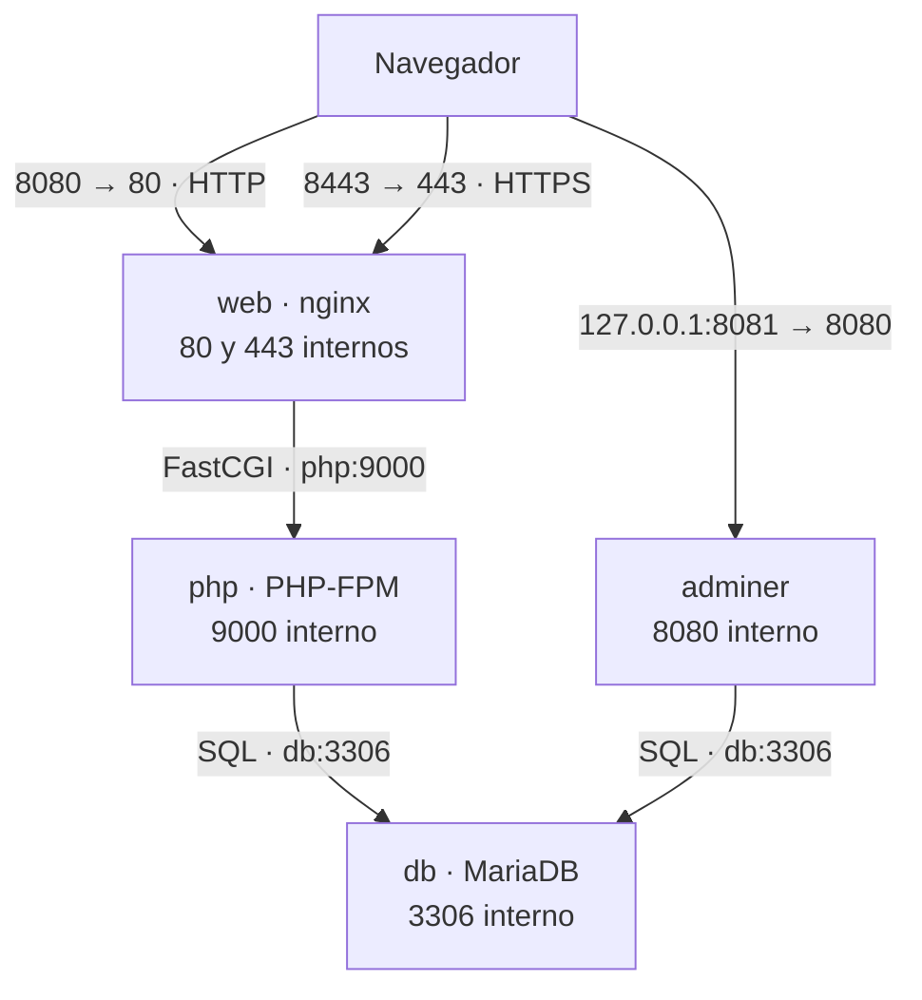

# NovaHarvest

Proyecto de Implantación de Aplicaciones Web de Álvaro García Muñoz.

NovaHarvest permite consultar excedentes agrícolas del Valle del Jerte
y registrar solicitudes de aviso de compradores interesados.

La aplicación utiliza nginx, PHP-FPM, MariaDB y Adminer,
gestionados mediante Docker Compose.

## 1. Arranque

### Requisitos

- Git.
- Docker con Docker Compose.
- OpenSSL para generar el certificado autofirmado.
- En Windows, Docker Desktop arrancado y una terminal Git Bash.
  Git Bash incluye OpenSSL.

### Descargar el proyecto

```bash
git clone https://github.com/vjp-alvaroGM/NovaHarvest-iaplw.git novaharvest-iaplw
cd novaharvest-iaplw
```

### Preparar las variables

```bash
cp .env.example .env
```

Abrir `.env` y configurar estas cuatro variables:

| Variable | Contenido |
|---|---|
| `DB_NAME` | `novaharvest` |
| `DB_USER` | `novaharvest_app` |
| `DB_PASS` | Contraseña elegida para la aplicación |
| `DB_ROOT_PASSWORD` | Contraseña elegida para root de MariaDB |

Sustituir los marcadores de contraseña de la plantilla por los valores
que se utilizarán en este equipo.

Compose lee `.env` y sustituye las referencias `${VAR}` del archivo
`compose.yaml`.

`.env` está excluido del repositorio mediante `.gitignore`.

### Generar el certificado

Desde Linux o Git Bash en Windows:

```bash
mkdir -p nginx/certs
MSYS_NO_PATHCONV=1 openssl req -x509 -nodes -days 365 -newkey rsa:2048 -keyout nginx/certs/novaharvest.key -out nginx/certs/novaharvest.crt -subj "/CN=localhost"
```

`MSYS_NO_PATHCONV=1` evita que Git Bash convierta el valor
`/CN=localhost` en una ruta de Windows.

Se generan dos archivos:

- `novaharvest.crt`, el certificado autofirmado para localhost.
- `novaharvest.key`, su clave privada.

La carpeta `nginx/certs/` está excluida del repositorio.

### Levantar el entorno

```bash
docker compose config -q
docker compose up -d --build
docker compose ps
```

El servicio `db` debe aparecer como `healthy`.

PHP y Adminer esperan a que MariaDB supere su comprobación de estado.
nginx arranca después de PHP.

### Cargar las tablas y los datos iniciales

Este paso se realiza una vez, después del primer arranque de MariaDB
con un volumen nuevo.

Copiar el script al contenedor:

```bash
docker compose cp ./db/novaharvest.sql db:/tmp/novaharvest.sql
```

Abrir el cliente de MariaDB como root:

```bash
docker compose exec db mariadb --default-character-set=utf8mb4 -u root -p
```

Introducir la contraseña configurada en `DB_ROOT_PASSWORD`.
Dentro del cliente de MariaDB, ejecutar:

```sql
SOURCE /tmp/novaharvest.sql;
SHOW TABLES FROM novaharvest;
SELECT * FROM novaharvest.excedentes;
SHOW GRANTS FOR 'novaharvest_app'@'%';
EXIT;
```

Deben aparecer las tablas `excedentes` y `avisos`, cinco productos
y los permisos `SELECT, INSERT` sobre `novaharvest.*`.

### Direcciones

| Página | URL |
|---|---|
| Inicio | https://localhost:8443/ |
| Excedentes | https://localhost:8443/excedentes.php |
| Formulario de avisos | https://localhost:8443/avisos.html |
| Respuesta al formulario | https://localhost:8443/avisos.php |
| Calendario de temporada | https://localhost:8443/temporada.md |
| Estado del servidor | https://localhost:8443/estado.php |
| Adminer | http://localhost:8081/ |

`avisos.php` se utiliza enviando el formulario de `avisos.html`
mediante POST.

Las peticiones a `http://localhost:8080/` se redirigen a HTTPS
en el puerto 8443, conservando la ruta solicitada.

El navegador muestra un aviso porque el certificado es autofirmado.
Para comprobar el entorno desde la terminal se puede usar `curl -k`.

### Comprobaciones iniciales

```bash
curl -I http://localhost:8080/excedentes.php
curl -k -i https://localhost:8443/estado.php
curl -k -I https://localhost:8443/temporada.md
curl -k -I -H "Accept-Encoding: gzip" https://localhost:8443/css/estilos.css
```

Resultados esperados:

- HTTP devuelve una redirección `301` a HTTPS.
- Estado devuelve `200` y muestra la fecha, el contenedor y la versión de MariaDB.
- El calendario se sirve como `text/plain; charset=utf-8`.
- El CSS se sirve con `Content-Encoding: gzip`.

En Excedentes deben aparecer cuatro productos con más de cero kilos.
El calabacín queda fuera de la tabla porque tiene cero kilos.

### Parar y volver a arrancar

```bash
docker compose down
docker compose up -d
```

`down` elimina los contenedores y la red del proyecto.
Los datos permanecen en el volumen `dbdata`.

### Empezar desde cero

El siguiente comando elimina también el volumen y todos los datos
guardados en MariaDB:

```bash
docker compose down -v
```

Para reconstruir el entorno:

```bash
docker compose up -d --build
```

Después hay que repetir la carga de `db/novaharvest.sql`.

Las variables de inicialización `MARIADB_*` se aplican cuando el
volumen de MariaDB está vacío. Cambiar una contraseña en `.env`
con un volumen existente requiere actualizar también la cuenta
correspondiente en MariaDB.

## 2. Arquitectura



### Servicios y almacenamiento

| Servicio | Imagen | Puertos publicados | Almacenamiento |
|---|---|---|---|
| `web` | `nginx:1.27-alpine` | `8080:80` y `8443:443` | `./web`, configuración de nginx y certificados, en solo lectura |
| `php` | Construida desde `php:8.3-fpm-alpine` | Ninguno | `./web` y archivos de configuración, en solo lectura |
| `db` | `mariadb:11` | Ninguno | Volumen `dbdata` en `/var/lib/mysql` |
| `adminer` | `adminer:5` | `127.0.0.1:8081:8080` | Sin volumen propio |

Compose crea una red compartida. Los servicios se localizan por su
nombre, por ejemplo `php` y `db`.

### Recorrido de una petición a excedentes.php

1. El navegador solicita la página por HTTP en el puerto 8080.
2. nginx devuelve una redirección 301 a HTTPS en el puerto 8443.
3. El navegador realiza la petición HTTPS y nginx recibe la conexión
   en el puerto 443 del contenedor.
4. El bloque de archivos `.php` envía la petición a `php:9000`
   mediante FastCGI.
5. `SCRIPT_FILENAME` indica a PHP-FPM la ruta del script.
6. PHP conecta con MariaDB usando PDO y las variables de entorno.
7. Consulta los excedentes con más de cero kilos y genera la tabla HTML.
8. nginx devuelve el resultado al navegador mediante HTTPS.

nginx y PHP montan `./web` en `/usr/share/nginx/html`.
Esto permite que ambos utilicen la misma ruta para cada script.

## 3. Configuración

| Archivo | Servicio | Ubicación dentro del contenedor | Función |
|---|---|---|---|
| `compose.yaml` | Todos | Lo interpreta Compose en el equipo anfitrión | Define servicios, puertos, variables, volúmenes y dependencias |
| `.env` | Compose | Lo lee Compose en el equipo anfitrión | Contiene los valores reales de las variables |
| `.env.example` | Preparación | Sirve de plantilla en el equipo anfitrión | Documenta las variables necesarias |
| `nginx/default.conf` | `web` | `/etc/nginx/conf.d/default.conf` | Configura HTTPS, redirección, errores, compresión, Markdown y FastCGI |
| `nginx/certs/novaharvest.crt` | `web` | `/etc/nginx/certs/novaharvest.crt` | Certificado autofirmado |
| `nginx/certs/novaharvest.key` | `web` | `/etc/nginx/certs/novaharvest.key` | Clave privada del certificado |
| `php/Dockerfile` | `php` | Se utiliza al construir la imagen | Instala `pdo_mysql` y `mysqli` |
| `php/www.conf` | `php` | `/usr/local/etc/php-fpm.d/www.conf` | Configura el pool de PHP-FPM y sus procesos |
| `php/php.ini` | `php` | `/usr/local/etc/php/conf.d/novaharvest.ini` | Configura memoria, errores y zona horaria |
| `db/novaharvest.sql` | `db` | Se copia a `/tmp/novaharvest.sql` para cargarlo | Crea tablas, datos iniciales y privilegios |

### Medidas aplicadas

- PHP-FPM y MariaDB utilizan puertos internos.
- Adminer escucha en la interfaz local `127.0.0.1`.
- PHP recibe las credenciales del usuario de la aplicación.
- `.env` y los certificados están excluidos de Git.
- El acceso a la web utiliza HTTPS.
- PHP tiene `display_errors = Off` y `log_errors = On`.
- nginx limita el cuerpo de las peticiones a 64 KB.
- Las inserciones de avisos utilizan consultas preparadas.
- Las páginas de error están configuradas como `internal`.

## 4. Base de datos

La base de datos se llama `novaharvest`.

### Tabla excedentes

| Columna | Tipo |
|---|---|
| `id` | `INT AUTO_INCREMENT PRIMARY KEY` |
| `producto` | `VARCHAR(100) NOT NULL` |
| `productor` | `VARCHAR(100) NOT NULL` |
| `pueblo` | `VARCHAR(100) NOT NULL` |
| `kilos` | `INT NOT NULL DEFAULT 0` |
| `precio_kg` | `DECIMAL(6,2) NOT NULL` |

Contiene cinco productos iniciales.
La página `excedentes.php` muestra los cuatro que tienen existencias
y presenta los precios con dos decimales, coma decimal y símbolo de euro.

### Tabla avisos

| Columna | Tipo |
|---|---|
| `id` | `INT AUTO_INCREMENT PRIMARY KEY` |
| `nombre` | `VARCHAR(100) NOT NULL` |
| `email` | `VARCHAR(150) NOT NULL` |
| `producto` | `VARCHAR(100) NOT NULL` |
| `fecha` | `DATETIME DEFAULT CURRENT_TIMESTAMP` |

`avisos.php` guarda los datos enviados por el formulario.
MariaDB asigna automáticamente la fecha del registro.

### Usuario de la aplicación

El usuario es `novaharvest_app` y tiene estos permisos:

- `SELECT`, para consultar los excedentes y la versión de MariaDB.
- `INSERT`, para registrar los avisos.

Los permisos se aplican a `novaharvest.*`.
Este usuario carece de permisos para borrar tablas o registros,
modificar su estructura o administrar usuarios.

### Comprobar los privilegios

```bash
docker compose exec db mariadb -u root -p
```

Dentro del cliente:

```sql
SHOW GRANTS FOR 'novaharvest_app'@'%';
EXIT;
```

El resultado debe incluir `USAGE` y `SELECT, INSERT` sobre
`novaharvest.*`.

### Consultar datos con el usuario de la aplicación

```bash
docker compose exec db mariadb --default-character-set=utf8mb4 -u novaharvest_app -p novaharvest
```

Dentro del cliente:

```sql
SELECT * FROM excedentes;
SELECT * FROM avisos;
EXIT;
```

### Acceder con Adminer

Abrir `http://localhost:8081/` y utilizar:

| Campo | Valor |
|---|---|
| Sistema | MySQL |
| Servidor | `db` |
| Usuario | `novaharvest_app` |
| Contraseña | El valor de `DB_PASS` de este equipo |
| Base de datos | `novaharvest` |